# GitHub Enhancer

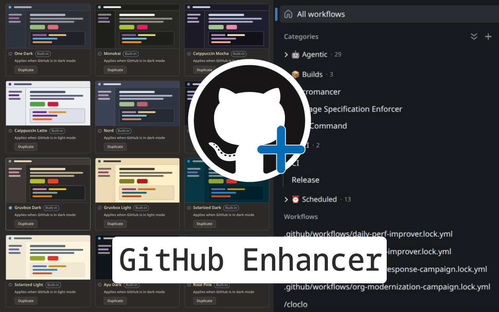

---

> Chrome and Firefox extension that enhances GitHub experience in multiple places.

This extension focuses in bringing new features and customizations to the GitHub pages to improve UX, please feel free to recommend this if you like it and give us [feedback](https://github.com/nerdtronik/github-enhancer/discussions) as much as possible.

---

## Install
[chrome-extension]: https://chromewebstore.google.com/detail/github-enhancer/mgokfjhlgfobbhmnldjanblnjjjhlajo 'Chrome Extension'
[][chrome-extension] [][chrome-extension]

## Features

### Actions

| Feature                                                                               | Description                                                                | Preview                                                                                                                                                                                                                   |
| ------------------------------------------------------------------------------------- | -------------------------------------------------------------------------- | ------------------------------------------------------------------------------------------------------------------------------------------------------------------------------------------------------------------------- |
| [**Workflows categories**](./docs/features/actions.md#workflows-categories)           | Categories in workflows list, finally 🙌                                   | 

Click to expand image
 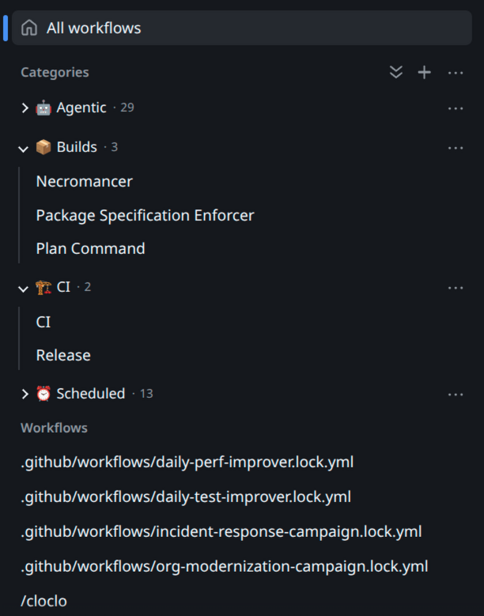 
 |
| [**Workflows filter**](./docs/features/actions.md#workflows-filter)                   | You can search your workflows in that massive list 🔎                      | 

Click to expand image
 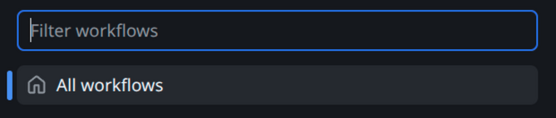 
     |
| [**Remove _"Show more"_ button**](./docs/features/actions.md#remove-show-more-button) | All workflows list loads from the beginning 🔃                             | 

Click to expand image
 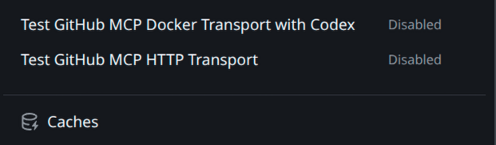 
         |
| [**Resizable sidebar**](./docs/features/actions.md#resizable-sidebar)                 | Resize the sidebar as you like 🫰                                          | 

Click to expand image
 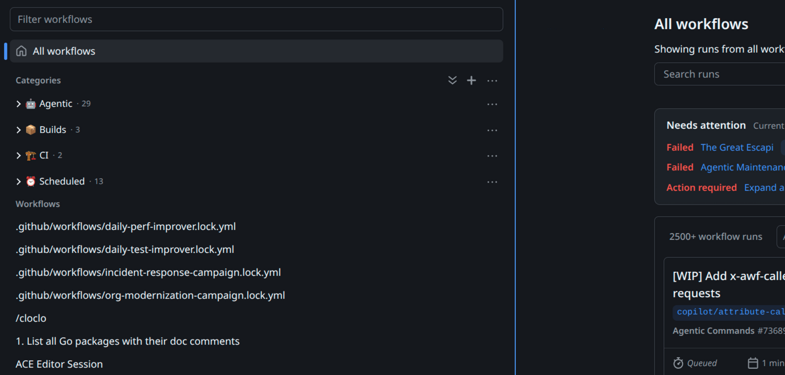 
        |
| [**Needs Attention section**](./docs/features/actions.md#needs-attention-section)     | (optional) section that shows failing workflows whiting the loaded list 🔭 | 

Click to expand image
 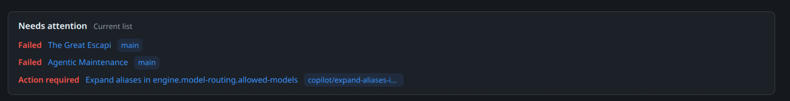 
      |
| [**Enhanced workflows view**](./docs/features/actions.md#enhanced-workflows-view)     | (optional) Enhanced worflow view with cards and no animations 🎛️           | 

Click to expand image
 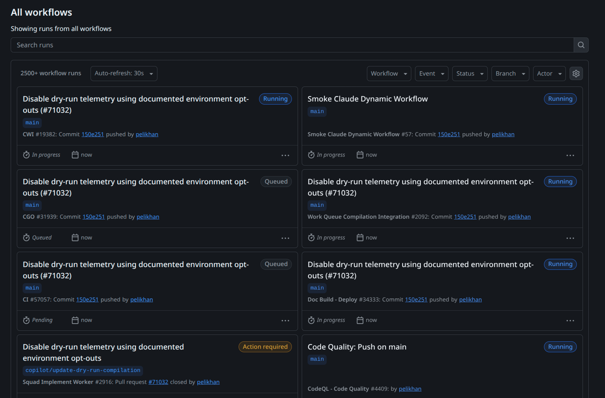 
        |

### Pull Requests

| Feature                                                                                              | Description                                                                                                                                                                                    | Preview                                                                                                                                                                                                                                                                                                                                                                                    |
| ---------------------------------------------------------------------------------------------------- | ---------------------------------------------------------------------------------------------------------------------------------------------------------------------------------------------- | ------------------------------------------------------------------------------------------------------------------------------------------------------------------------------------------------------------------------------------------------------------------------------------------------------------------------------------------------------------------------------------------ |
| [**Conversation filters**](./docs/features/pull-requests.md#conversation-filters)                    | This allows you to filter all PR comments and events, making the process to read/review PRs more easy 🗃️                                                                                       | 

Click to expand image
 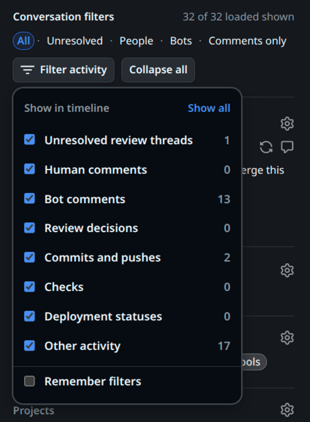 
                                                                                                                                                              |
| [**Collapsible comments**](./docs/features/pull-requests.md#collapsible-comments)                    | As the name says, you can collapse comments (threads already support this) 📪                                                                                                                  | 

Click to expand image
 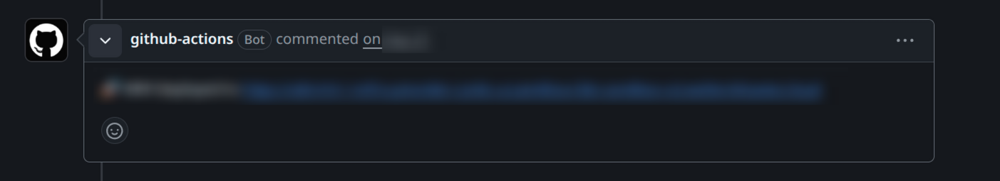 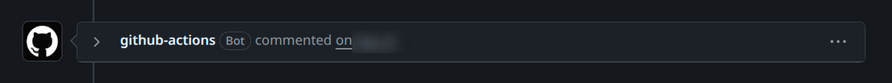 
 |
| [**Merge & Code buttons in navbar**](./docs/features/pull-requests.md#merge--code-buttons-in-navbar) | When tou scroll, the top navbar collapses and these two buttons dissapear, forcing you to go to the top/bottom of the page to see its content, this carries those buttons during all scroll 🧭 | 

Click to expand image
 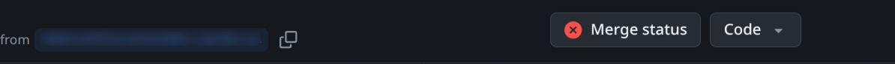 
                                                                                                                                                                  |

### Action Run

| Feature                                                                              | Description                                                    | Preview                                                                                                                                                                                                                         |
| ------------------------------------------------------------------------------------ | -------------------------------------------------------------- | ------------------------------------------------------------------------------------------------------------------------------------------------------------------------------------------------------------------------------- |
| [**Resizable sidebar**](./docs/features/action-run.md#resizable-sidebar)             | Jobs list sidebar resizable 🫰                                 | 

Click to expand image
 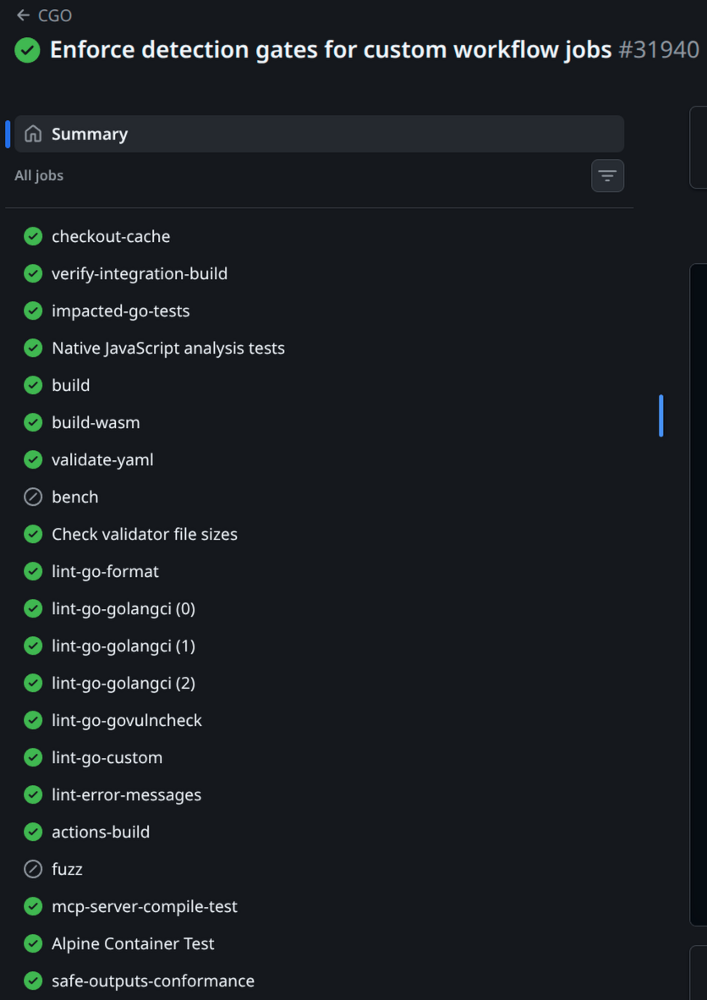 
       |
| [**Collapsible information**](./docs/features/action-run.md#collapsible-information) | Now footer information is collapsible 📪                       | 

Click to expand image
 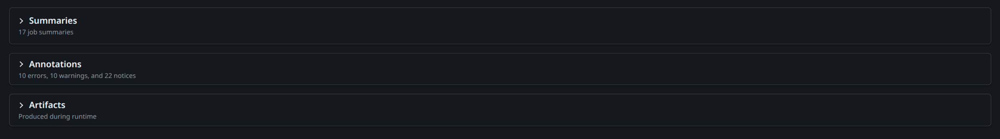 
 |
| [**Enhanced Jobs view**](./docs/features/action-run.md#enhanced-jobs-view)           | New Jobs workflow enhanced view (optimal for big workflows) 🎛️ | 

Click to expand image
 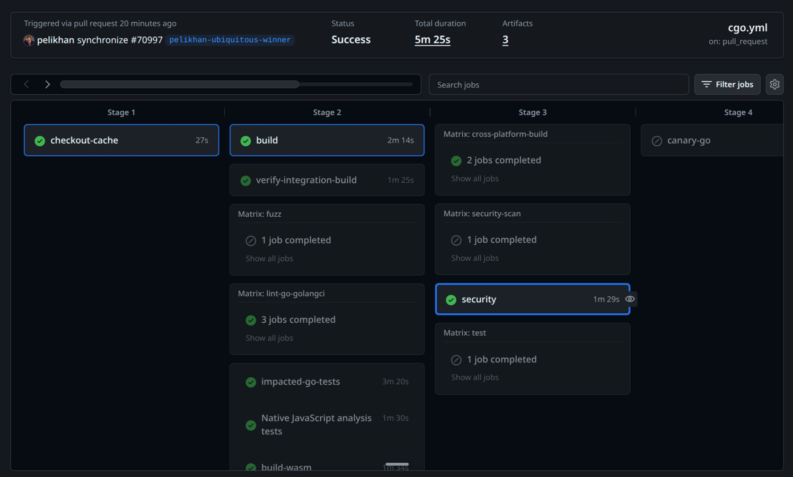 
      |

### Themes

| Feature                                                                        | Description                                                                                                                                                                                                                                                                                               | Preview                                                                                                                                                                                                                 |
| ------------------------------------------------------------------------------ | --------------------------------------------------------------------------------------------------------------------------------------------------------------------------------------------------------------------------------------------------------------------------------------------------------- | ----------------------------------------------------------------------------------------------------------------------------------------------------------------------------------------------------------------------- |
| [**IDE themes for GitHub**](./docs/features/themes.md)                         | 200+ built-in themes that recolor the whole site and code, chosen in a Custom themes section (Dark and Light) on the GitHub appearance settings page  | 

Click to expand image
 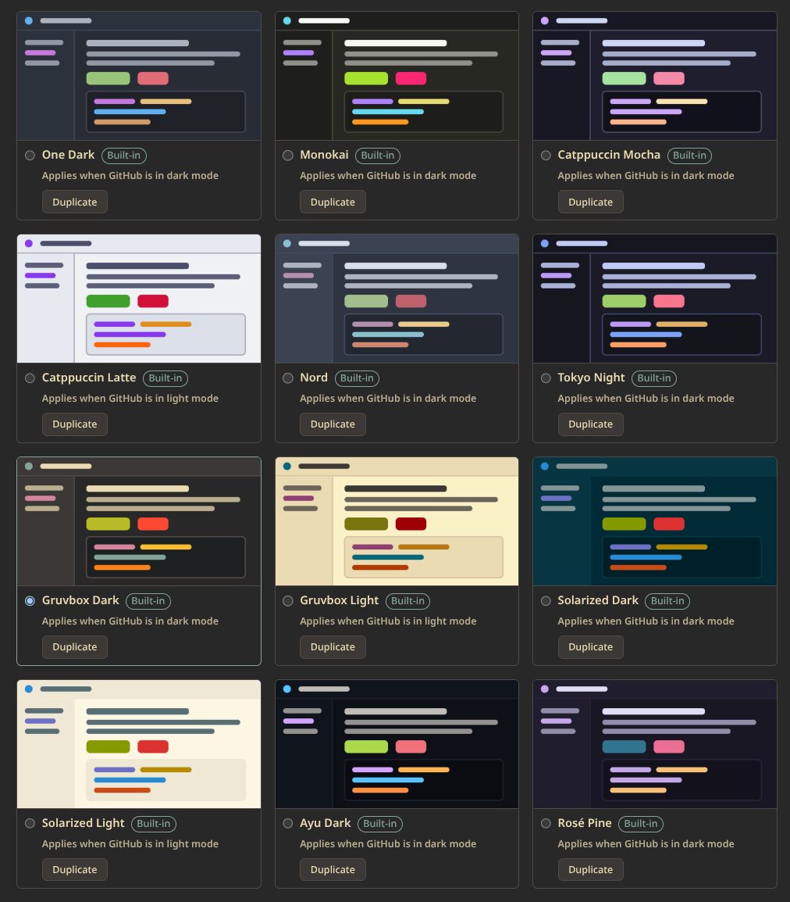 
                |
| [**Custom themes**](./docs/features/themes.md#creating-a-custom-theme)         | Create, edit, duplicate, delete, import and export your own themes                                                                                                                                                                                                                                        | 

Click to expand image
 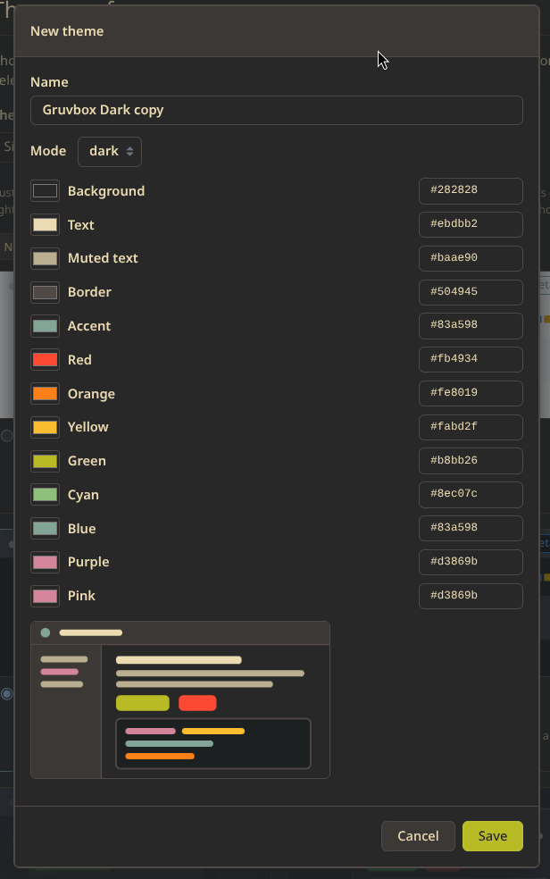 
 |
| [**Active theme per mode**](./docs/features/themes.md#modes-and-active-themes) | One Active theme for light and one for dark, applied on every github.com page                                                                                                                                                                                                                             | —                                                                                                                                                                                                                       |

### Quality of Life

| Feature                                                                         | Description                                                                                                                               | Preview                                                                                                                                                                                                          |
| ------------------------------------------------------------------------------- | ----------------------------------------------------------------------------------------------------------------------------------------- | ---------------------------------------------------------------------------------------------------------------------------------------------------------------------------------------------------------------- |
| [**Go to Top**](./docs/features/quality-of-life.md#go-to-top)                   | Go to top button for all scrollable main views 🔝                                                                                         | 

Click to expand image
 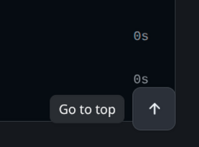 
 |
| [**No more trackers**](./docs/features/quality-of-life.md#no-more-trackers)     | Blocks basic telemetry requests                                                                                                           | _None_                                                                                                                                                                                                           |
| [**Refresh now button**](./docs/features/quality-of-life.md#refresh-now-button) | A refresh button next to the Auto-refresh dropdown, with a short cooldown against spamming                                                | _None_                                                                                                                                                                                                           |
| [**Enterprise header tab**](./docs/features/header.md#enterprise-header-tab)    | Collapses the extra "GitHub Enterprise" row at the top of the header of org-managed repos into a small tab under the header (best-effort) | _None_                                                                                                                                                                                                           |

## Collaboration

If you are a developer and you want to contribute, please feel free to open a [Pull Request](https://github.com/nerdtronik/github-enhancer/pulls) and I will review it and test it.

If you are not a developer but you still want to contribue, you can always create a [new issue](https://github.com/nerdtronik/github-enhancer/issues) to report any problems or you can go to the [discussions page](https://github.com/nerdtronik/github-enhancer/discussions) and open some topic there.

### Load locally

- **Chrome:** open `chrome://extensions`, enable **Developer mode**, click **Load unpacked**, and select this folder.
- **Firefox:** open `about:debugging#/runtime/this-firefox`, click **Load Temporary Add-on**, and select this folder's `manifest.json`. Firefox removes temporary extensions when it closes.

> Refresh existing GitHub tabs after loading the extension.

### Tests

With Node.js 20+ and dependencies installed (`npm install`), run `npm test` in this folder.

## References

- [Releasing](./docs/releasing.md)
- [Chrome content scripts](https://developer.chrome.com/docs/extensions/develop/concepts/content-scripts)
- [Firefox temporary installation](https://extensionworkshop.com/documentation/develop/temporary-installation-in-firefox/).

## Privacy

The extension collects no data and sends nothing to any server. See the [Privacy Policy](./PRIVACY.md).

## License

[The MIT License (MIT)](./LICENSE.md)
